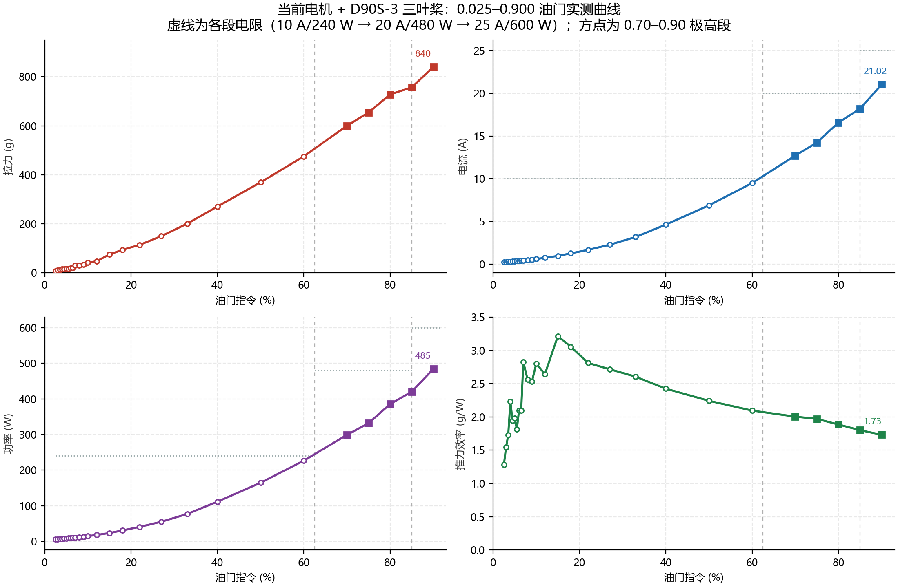

# 当前电机 + D90S-3 三叶桨：全档位实测汇总

- 汇总日期：2026-10-18
- 测量范围：油门指令 **0.025 – 0.900**（27 个不同档位，28 条有效记录，含 0.060 复测）
- 数据来源：`integration_runs/high_range_campaign_20261018/全档位数据.csv`（0.025–0.60 已发布统计）+
  0.70 / 0.75 / 0.80 / 0.85 / 0.90 五次运行各自的 `observed_cv.jsonl` 目标窗口重算
- 合并数据：[全档位数据_合并.csv](全档位数据_合并.csv)；绘图脚本：[make_charts.py](make_charts.py)
- **1.00 档未测**（在 0.90 完成后按要求暂停）

---

## 1. 汇总表

拉力/电流/电压均取每档 **目标保持窗口** 内的样本统计；峰值同样来自该窗口（0.025 档运行未记录目标窗口，故峰值留空）。

| 指令 | 油门 | 拉力均值 g | 拉力范围 g | 电压 V | 电流均值 A | 电流峰值 A | 功率均值 W | 功率峰值 W | 效率 g/W | 运行 |
|---:|---:|---:|---:|---:|---:|---:|---:|---:|---:|---|
| 0.025 | 2.5% | 6.98 | 6–9 | 24.70 | 0.220 | — | 5.44 | — | 1.28 | `20261017_231528_step0.025_20s_3ea310` |
| 0.03 | 3.0% | 9.33 | 8–11 | 24.62 | 0.245 | 0.25 | 6.05 | 6.2 | 1.54 | `20261017_232719_step0.03_15s_42d751` |
| 0.035 | 3.5% | 11.13 | 10–13 | 24.60 | 0.261 | 0.27 | 6.43 | 6.6 | 1.73 | `20261017_233303_step0.035_15s_49959f` |
| 0.04 | 4.0% | 15.60 | 13–17 | 24.60 | 0.283 | 0.29 | 6.99 | 7.1 | 2.23 | `20261017_234256_step0.04_15s_6c5979` |
| 0.045 | 4.5% | 14.43 | 13–16 | 24.60 | 0.301 | 0.31 | 7.42 | 7.6 | 1.94 | `20261017_235830_step0.045_15s_c42b30` |
| 0.05 | 5.0% | 16.11 | 13–18 | 24.60 | 0.330 | 0.33 | 8.13 | 8.1 | 1.98 | `20261018_000135_step0.05_15s_a80995` |
| 0.055 | 5.5% | 15.51 | 11–18 | 24.60 | 0.347 | 0.36 | 8.54 | 8.9 | 1.81 | `20261018_002233_step0.055_15s_b641e4` |
| 0.06 | 6.0% | 19.09 | 18–21 | 24.60 | 0.370 | 0.38 | 9.10 | 9.3 | 2.10 | `20261018_002816_step0.06_15s_9fc5e3` |
| 0.06 | 6.0% | 25.74 | 24–29 | 24.50 | 0.371 | 0.38 | 9.09 | 9.3 | 2.83 | `20261018_152641_step0.06_15s_6ab7f8` |
| 0.065 | 6.5% | 20.43 | 18–24 | 24.40 | 0.399 | 0.40 | 9.73 | 9.8 | 2.10 | `20261018_165222_step0.065_15s_761fe1` |
| 0.07 | 7.0% | 29.38 | 28–32 | 24.50 | 0.425 | 0.43 | 10.40 | 10.5 | 2.83 | `20261018_154244_step0.07_15s_7168ec` |
| 0.08 | 8.0% | 29.97 | 28–32 | 24.40 | 0.480 | 0.49 | 11.70 | 12.0 | 2.56 | `20261018_165333_step0.08_15s_362997` |
| 0.09 | 9.0% | 32.95 | 29–39 | 24.40 | 0.535 | 0.54 | 13.00 | 13.2 | 2.53 | `20261018_165445_step0.09_15s_9c51eb` |
| 0.1 | 10.0% | 41.15 | 37–44 | 24.50 | 0.600 | 0.61 | 14.68 | 14.9 | 2.80 | `20261018_154340_step0.1_15s_6a7a6b` |
| 0.12 | 12.0% | 46.93 | 42–51 | 24.37 | 0.728 | 0.74 | 17.74 | 18.1 | 2.65 | `20261018_165554_step0.12_15s_da7a2a` |
| 0.15 | 15.0% | 74.83 | 66–81 | 24.50 | 0.952 | 1.06 | 23.27 | 26.0 | 3.22 | `20261018_154446_step0.15_15s_ad2f9d` |
| 0.18 | 18.0% | 93.60 | 81–103 | 24.40 | 1.253 | 1.32 | 30.62 | 32.3 | 3.06 | `20261018_163532_step0.18_15s_515c9e` |
| 0.22 | 22.0% | 113.89 | 98–122 | 24.40 | 1.660 | 1.68 | 40.50 | 41.0 | 2.81 | `20261018_163706_step0.22_15s_aff1e3` |
| 0.27 | 27.0% | 149.46 | 111–168 | 24.32 | 2.259 | 2.30 | 54.98 | 56.1 | 2.72 | `20261018_164058_step0.27_15s_87321e` |
| 0.33 | 33.0% | 200.37 | 155–288 | 24.24 | 3.169 | 3.21 | 76.88 | 78.0 | 2.61 | `20261018_164311_step0.33_15s_f26395` |
| 0.4 | 40.0% | 270.28 | 193–280 | 24.13 | 4.618 | 4.72 | 111.43 | 114.5 | 2.43 | `20261018_164446_step0.4_15s_186192` |
| 0.5 | 50.0% | 369.16 | 258–382 | 23.95 | 6.873 | 6.97 | 164.59 | 167.3 | 2.24 | `20261018_164647_step0.5_15s_1a6dd9` |
| 0.6 | 60.0% | 475.12 | 326–485 | 23.75 | 9.486 | 9.71 | 226.63 | 232.1 | 2.10 | `20261018_164842_step0.6_15s_8758e1` |
| 0.7 | 70.0% | 600.00 | 582–611 | 23.56 | 12.705 | 13.00 | 299.24 | 308.1 | 2.01 | `20261018_171131_step0.7_10s_2f1284` |
| 0.75 | 75.0% | 654.27 | 438–688 | 23.35 | 14.229 | 15.00 | 331.91 | 352.5 | 1.97 | `20261018_191343_step0.75_10s_cd2fcc` |
| 0.8 | 80.0% | 727.95 | 476–755 | 23.29 | 16.574 | 17.30 | 385.84 | 406.6 | 1.89 | `20261018_171300_step0.8_10s_abaa83` |
| 0.85 | 85.0% | 756.84 | 500–804 | 23.12 | 18.200 | 19.50 | 420.28 | 452.4 | 1.80 | `20261018_191708_step0.85_10s_c97335` |
| 0.9 | 90.0% | 839.76 | 540–889 | 23.06 | 21.024 | 22.90 | 484.53 | 542.7 | 1.73 | `20261018_172006_step0.9_10s_8d86cb` |

> 表中 0.060 出现两次：第一条为早期 15 s 运行，第二条为实验场景调整后的复测。绘图取第一条为主序列，复测点单独以菱形标出。
>
> 0.85 档目标窗口内共 45 帧，19 帧三表齐全有效。其中 17 帧集中在 776–804 g（中位数 **781 g**），仅 2 帧为 500 / 525 g（保持开始时的短暂下探）。为与其余档位口径一致，表中仍用全部有效样本的均值 756.84 g；以中位数看，0.85 更接近 0.80–0.90 的线性插值约 784 g。

---

## 2. 曲线图

- **[01_全段四联图](曲线图/01_全段四联图.png)** — 拉力 / 电流 / 功率 / 效率四联，线性横轴，虚线为各段电限
- **[02_拉力-油门](曲线图/02_拉力-油门.png)** — 对数横轴，便于同时看清低油门段与高油门段
- **[03_电流-油门](曲线图/03_电流-油门.png)** — 含 10 A / 20 A / 25 A 三档电限参考线
- **[04_功率-油门](曲线图/04_功率-油门.png)** — 含 240 W / 480 W / 600 W 三档电限参考线
- **[05_效率-油门](曲线图/05_效率-油门.png)** — 推力效率 g/W 随油门变化
- **[06_拉力-功率](曲线图/06_拉力-功率.png)** — 拉力对功率，点色表示油门
- **[07_低油门段放大](曲线图/07_低油门段放大.png)** — 0.025–0.200 拉力与效率细节

图中空心圆为普通实测点，实心方点为 0.70–0.90 极高油门段。



---

## 3. 主要规律

1. **拉力随油门单调上升**，从 0.025 的约 7 g 到 0.90 的约 840 g，跨度约 120 倍。0.70–0.90 段近似线性：以 0.85 的中位数计，每 10% 油门约增加 110–130 g。
2. **电流与功率近似指数增长**。电流从 0.22 A 增至 21.02 A（约 95 倍），功率从 5.4 W 增至 484.5 W（约 89 倍）。0.70→0.75→0.80→0.85→0.90 折算每 10% 油门的电流增量约 3.0–5.6 A、功率增量约 65–130 W，且整体在变大。
3. **推力效率峰值在 0.15 附近（约 3.22 g/W）**，随后持续下降：0.22 为 2.81，0.40 为 2.43，0.60 为 2.10，0.75 为 1.97，0.85 为 1.80，0.90 已降至 1.73 g/W。高油门段能效损失明显。
4. **电压随负载下降**：空载/低油门约 24.6–24.7 V，0.90 时降至 23.06 V，说明电池内阻与线损在高电流下已不可忽略。
5. **低油门段（≤0.06）数据噪声大**：该区间拉力只有 7–26 g，与拉力显示 1 g 分辨率、±3 g 零点漂移同量级，单点差异（如 0.04 与 0.045、0.055 与 0.06）不宜当作真实趋势；0.060 两次运行相差约 6.7 g 也说明这一点。
6. **0.33 / 0.40 / 0.50 等点的拉力范围下沿偏低**（如 0.33 的 155 g、0.60 的 326 g），是目标窗口内包含起始瞬态或机械振动导致的短期下探，均值更具代表性。

---

## 4. 关键事件与门槛变化

| 时间/运行 | 事件 | 处理 |
|---|---|---|
| 0.70 / 0.80 | 在 20 A / 480 W（硬 22 A / 528 W）门槛下完成 10 s 保持 | 正常 |
| `bb55d8`（0.90 第一次） | 首个高电流样本 22.1 A / 512.7 W @ 23.2 V，触发 22 A **硬**上限立即中止 | 未计入；已验证 NaN 停机、ACK、servo1→0、其余通道 0、相机正常退出 |
| `031ba3`（0.90 第二次准备） | 拉力显示实际为 **-001**，旧 CV 解析器无负号单元，可读率仅 0.0825，基线检查失败 | 修复 `cv_mvp/instrument_reader.py` 负号解析 + `instrument_config.json` 的 `allow_negative`；未发任何电机指令 |
| 门槛调整 | 经确认将极高段门槛提高到 **25 A / 600 W 持续、27 A / 648 W 硬**，推力 2500 g | 记录在 `extreme_range_limits` 与每份 `result.json` |
| `8d86cb`（0.90 第三次） | 提高门槛后完成 10 s 保持，峰值 22.90 A / 542.7 W | 计入 |
| `190016` / `190322` / `190522`（0.75 前置检查） | 推力表断电重启后一度停在 `8.8.8.8.` 全段全亮，随后读数间歇不稳；三次 prepare-only / 基线检查失败 | 均未发任何电机指令；等显示稳定后通过 |
| `cd2fcc`（0.75） | 10 s 保持完成，654.3 g / 14.23 A / 331.9 W，峰值 15.00 A / 352.5 W | 计入；峰值仅为 25 A / 600 W 门槛的 60% / 59% |
| `c97335`（0.85） | 10 s 保持完成，756.8 g / 18.20 A / 420.3 W，峰值 19.50 A / 452.4 W | 计入；峰值分别为 25 A / 600 W 门槛的 78% / 75% |
| — | 按要求 **暂停，1.00 未测** | 待定 |

所有完成的运行均满足：停机 ACK 约 0.2 s、输出通道归零、其余通道为零、停机后 0.00 A / 0.00 W、无守护触发。

---

## 5. 关于 1.00 档

0.90 的峰值为 22.90 A / 542.7 W，已用掉 25 A / 600 W 门槛的大部分余量。按 0.70–0.90 的增量趋势粗略外推，1.00 档大约在 **930–950 g / 25–26 A / 570–610 W**，很可能触及甚至超过 25 A / 600 W 的持续上限（峰值更会接近 27 A / 648 W 硬限）。若后续要测，需要在明确接受更高门槛、或缩短保持时间的前提下单独批准。

---

## 6. 复现方式

```bash
cd <项目根目录>
python integration_runs/campaign_summary_20261018/make_charts.py
```

脚本重新读取已发布统计与各运行的 `observed_cv.jsonl`，重新生成：

- `全档位数据_合并.csv`
- `数据表_生成.md`
- `曲线图/*.png`

说明：0.025 档运行没有记录 `target_window`，其峰值列保持为空；其余档位峰值均由原始 CV 样本重算，与已发布均值交叉核对偏差在约 1.5% 以内。
